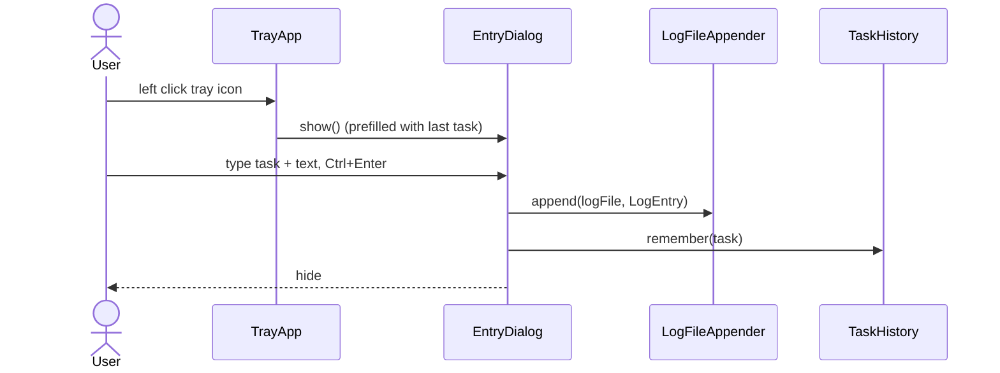

# Architecture

## Decisions

| Decision | Choice | Why |
|---|---|---|
| Language / JDK | Java 21 | Author is a Java dev; LTS. |
| UI | AWT `SystemTray` + Swing | In the JDK: no dependencies, small jar, fast start. |
| Build | Maven + `maven-shade-plugin` | Most common Java build; shade gives one runnable jar. |
| Tests | JUnit 5 (Jupiter) | De facto standard. |
| Logging | SLF4J + `slf4j-simple` | Common API, tiny engine, configurable by system properties, filterable per class/package. |
| Storage | Plain files in app dir | No database needed; easy to inspect. |
| License | Apache 2.0 | Author's choice; permissive, patent grant. |
| Distribution | Single jar via GitHub releases | "No install" requirement. |

Performance requirement: "super fast". Consequences: no frameworks, no reflection, build the dialog once and keep it hidden
between uses (showing is instant), read history once at startup, keep it in memory, append to disk on save.
Avoid slow Swing look-and-feel initialisation tricks; use the system L&F via `UIManager.getSystemLookAndFeelClassName()` set once.

## Components

```
Main -> AppDirectory -> Settings, TaskHistory
     -> TrayApp -> EntryDialog -> LogFileAppender (via a save callback)
                -> LogFileChooser -> Settings
```

- `appdir/AppDirectory`: `~/.daylog`; on Windows `%APPDATA%\daylog`. Created on demand.
- `settings/Settings`: `settings.properties` (`logFile=<absolute path>`). Remembers the last configured file; the chooser opens in its parent folder.
- `task/TaskName`: validated microtype (non-blank, single line, trimmed).
- `task/TaskHistory`: `tasks.txt`, one task per line, most recent last, de-duplicated (re-saving moves a task to last).
- `task/TaskCompletion`: pure function, given a typed prefix and the history returns the most recent task starting with it (case-insensitive).
- `entry/LogEntry`: timestamp + task + text. `entry/EntryFormatter`: renders the markdown block. `entry/LogFileAppender`: appends it.
- `ui/*`: Swing/AWT classes, no business logic.

## Entry format

`yyyy_MM_dd_HH_mm` + space + `` `task` `` + newline, then if text is not blank a fenced block with the text, then a final newline.
If the text itself contains a run of backticks of length >= 3, the fence is made longer than the longest run so the markdown stays valid.
Before appending, if the target file is non-empty and does not end with a newline, a newline is added first. The file is created if missing
(parents too). Writes use `StandardOpenOption.APPEND`, UTF-8.



## Gotchas

- Linux tray: GNOME removed legacy tray support; users need an AppIndicator extension. On Wayland the JDK tray runs through XWayland.
- `TrayIcon` mouse events differ between OS: use a `MouseListener` filtering button 1; the right-click menu is the AWT `PopupMenu` attached to the icon.
- If `SystemTray.isSupported()` is false the app logs an error and exits with a message on stderr.
- No log file configured when saving: the chooser opens first; cancelling aborts the save and keeps the dialog open.
- Swing must run on the Event Dispatch Thread; `Main` hands everything to `SwingUtilities.invokeLater`.
