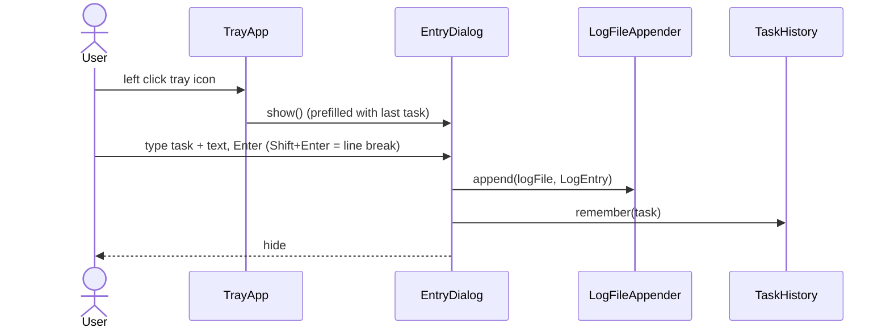

# Architecture

## Decisions

| Decision | Choice | Why |
|---|---|---|
| Language / JDK | Java 21 | Author is a Java dev; LTS. |
| UI | AWT `SystemTray` + Swing | In the JDK: no dependencies, small jar, fast start. |
| Build | Maven + `maven-shade-plugin` | Most common Java build; shade gives one runnable jar. |
| Tests | JUnit 5 (Jupiter) | De facto standard. |
| Logging | SLF4J + `slf4j-simple` | Common API, tiny engine, configurable by system properties, filterable per class/package. |
| Storage | Plain files in app dir | No database needed; easy to inspect. |
| License | Apache 2.0 | Author's choice; permissive, patent grant. |
| Distribution | Single jar via GitHub releases | "No install" requirement. |

Performance requirement: "super fast". Consequences: no frameworks, no reflection, build the dialog once and keep it hidden
between uses (showing is instant), read history once at startup, keep it in memory, append to disk on save.
The system look and feel (`UIManager.getSystemLookAndFeelClassName()`, GTK on Linux) is used because the owner prefers it; it costs about 450 ms of startup against the Swing default (measured 1.0 s vs 0.6 s). It is set once at startup.

## Components

```
Main -> AppDirectory -> Settings, TaskHistory
     -> TrayApp -> EntryDialog -> LogFileAppender (via a save callback)
                -> LogFileChooser -> Settings
```

- `appdir/AppDirectory`: `~/.daylog`; on Windows `%APPDATA%\daylog`. Created on demand.
- `settings/Settings`: `settings.properties` (`logFile=<absolute path>`). Remembers the last configured file; the chooser opens in its parent folder.
- `task/TaskName`: validated microtype (non-blank, single line, trimmed).
- `task/TaskHistory`: `tasks.txt`, one task per line, most recent last, de-duplicated (re-saving moves a task to last).
- `task/TaskCompletion`: pure function, given the typed text and the history returns up to 8 tasks starting with it (case-insensitive), most recent first. The dialog shows them in a drop-down (a `JPopupMenu` with a non-focusable `JList`, so typing continues in the field; Down/Up move, Enter chooses, Esc closes).
- `entry/LogEntry`: timestamp + task + text. `entry/EntryFormatter`: renders the markdown block. `entry/LogFileAppender`: appends it. `entry/EntryRecorder`: the save use case (find/ask log file, stamp time, append, remember task).
- `version/AppVersion`: reads `version.properties`, which Maven filters from `${project.version}` (only that file is filtered, see the pom `resources`).
- `ui/BookIcon`: draws the tray icon (open book) with Java2D at the size the tray asks for.
- `ui/*`: Swing/AWT classes, no business logic.

## Entry format

`yyyy_MM_dd_HH_mm` + space + `` `task` `` + newline, then if text is not blank a fenced block with the text, then a final newline.
If the text itself contains a run of backticks of length >= 3, the fence is made longer than the longest run so the markdown stays valid.
Before appending, if the target file is non-empty a separator is added so exactly one blank line sits between the old content and the new entry (nothing if the file already ends in a blank line, one line break if it ends in one, two if it ends in none; CRLF is understood). The file is created if missing
(parents too). Writes use `StandardOpenOption.APPEND`, UTF-8.



## Gotchas

- Linux tray: GNOME removed legacy tray support; users need an AppIndicator extension. On Wayland the JDK tray runs through XWayland.
- Keys: Enter saves from the text area and from the task field (unless a drop-down suggestion is highlighted, then Enter picks it); Shift+Enter inserts a line break (mapped to the text area's `insert-break` action); Ctrl+Enter also saves; Esc closes the drop-down, then the dialog.
- The tray menu has the version as a disabled item. The tray icon is drawn to fill the square the JDK reports (24x24 on Ubuntu/GNOME).
- The dialog opens with focus on the text area (the task rarely changes). Clicking the tray while the dialog is open only brings it to front, so typed text is not lost.
- `TrayIcon` mouse events differ between OS: use a `MouseListener` filtering button 1; the right-click menu is the AWT `PopupMenu` attached to the icon.
- If `SystemTray.isSupported()` is false the app logs an error and exits with a message on stderr.
- No log file configured when saving: the chooser opens first; cancelling aborts the save and keeps the dialog open.
- Swing must run on the Event Dispatch Thread; `Main` hands everything to `SwingUtilities.invokeLater`.
